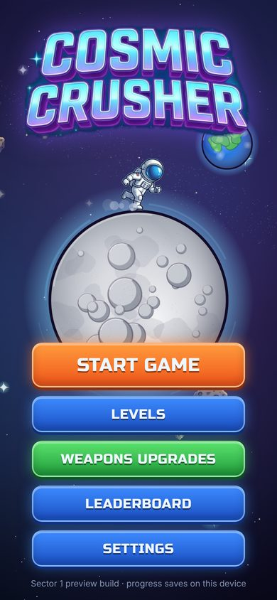
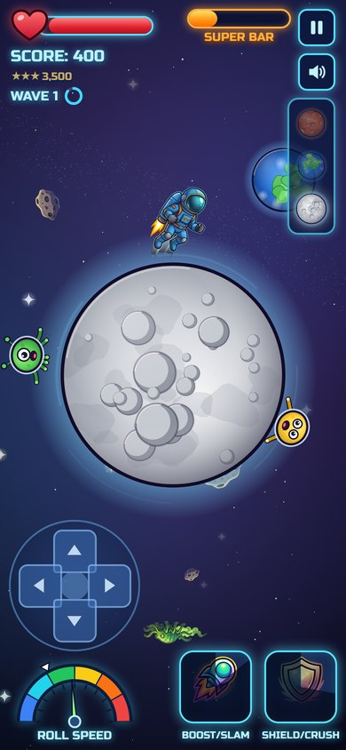
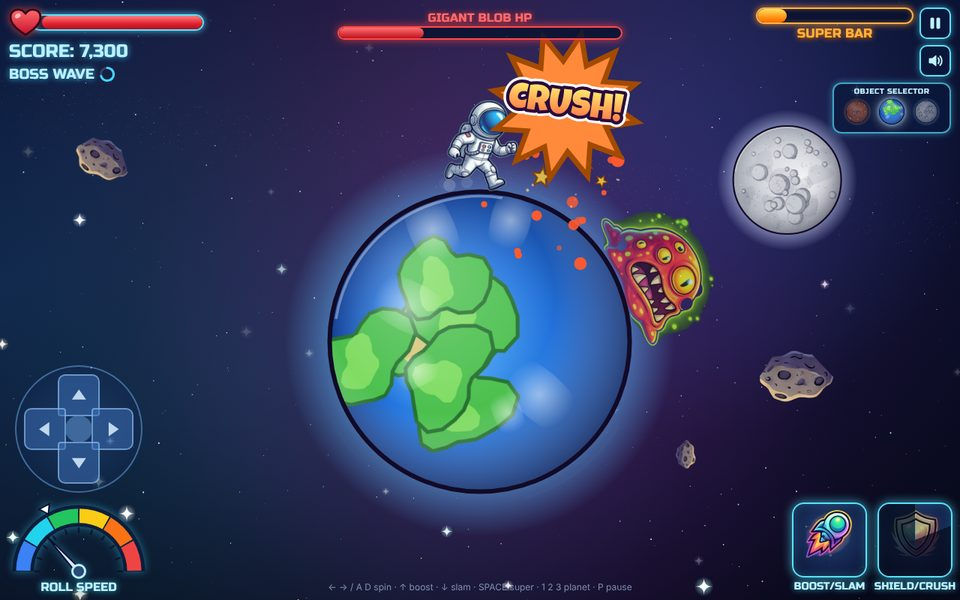

# AstroSpin

Spin the planet, roll the aliens under your astronaut, and **SPLAT!** them before they reach you.
A 2D arcade game for **YouTube Playables**, **Android**, **iPhone** and the web, built from the [game blueprint](docs/BLUEPRINT.md) and the art sheets in [`art/`](art/). Plain HTML5 Canvas + JavaScript: no engine, no network, about 0.5 MB.

<p>
  
  
  
</p>

This is the **Phase 1 preview**. It includes Sector 1 (levels 1–20) with a mini boss on level 10 and the Gigant Blob on level 20, the Classic White suit, the full HUD, settings and your top runs. Sectors 2–5, the other suits and the weapons come next (see [Roadmap](#roadmap)).

## Play it

- **On your computer:** double-click `index.html`. There's no install and no build step.
- **On your phone:** host it with GitHub Pages (below) and open the link. You can also run `python3 -m http.server` in this folder and browse to your computer's IP on port 8000.

### Put it online with GitHub Pages

1. Merge this branch into `main`.
2. In the GitHub repo, open **Settings → Pages**.
3. Under **Build and deployment**, choose **Deploy from a branch**, then pick `main` and `/ (root)`, and save.
4. After a minute the game is live at `https://<your-user>.github.io/<repo-name>/`.

## Builds

| Build | Command | Output |
|---|---|---|
| YouTube Playables | `python3 tools/build.py youtube` | `dist/cosmic-crusher-youtube.zip` (upload this) |
| Android / iOS web bundle | `python3 tools/build.py mobile` | `dist/mobile/` (used by Capacitor) |
| Both | `python3 tools/build.py all` | |

The build needs Python 3 with Pillow (`pip install pillow`). Every build is checked against YouTube's technical limits; it fails if a rule is broken:
- bundle under 30 MiB;
- no file over 30 MiB, and at most 8000 files;
- safe file names and relative paths only;
- no external URLs.

The game itself never touches the network: fonts, sprites and sound all ship in the bundle.

GitHub Actions ([`.github/workflows/build.yml`](.github/workflows/build.yml)) runs on every push. It produces three downloads under the run's **Artifacts**:
- `youtube-playables-bundle`
- `android-debug-apk`
- `android-release-aab-unsigned`

It also proves the iOS project compiles.

### YouTube Playables

The game is built to meet every MUST in the [Playables certification requirements](https://developers.google.com/youtube/gaming/playables/certification/requirements):

| Requirement | How the game meets it | Checked by |
|---|---|---|
| SDK loads before game code | the build puts the SDK `<script>` first | `build.py` |
| `firstFrameReady` on the loading screen, then `gameReady` when interactive | sent once each, in order. Boot doesn't wait for animation frames, so a hidden 0×0 WebView still reports ready | smoke test (mock SDK, hidden 1×1 start) |
| Cloud save only, after `loadData`; older saves handled | `js/platform.js` + `js/storage.js`; saves on level change and on pause | smoke test |
| `sendScore` integer equal to the best score in the save | the top run is sent whenever it improves | smoke test |
| Pause and resume only via `onPause`/`onResume`, and everything stops | the loop, input, audio and CSS animations stop; no Page Visibility API | smoke test |
| YouTube mute respected; sound without waiting for a tap; no in-game mute | the audio context follows `isAudioEnabled`; music starts at load when allowed; iOS silent switch respected | smoke test |
| No external calls; scripts allowed by YouTube's nonce CSP | fonts, art and sound all bundled; no inline scripts or handlers | `build.py` + smoke test under the CSP |
| Size: under 30 MiB total, files under 30 MiB, at most 8000 files, safe names, relative paths | about 1.1 MiB total, largest file about 170 KiB | `build.py` |
| Every aspect ratio, no orientation lock, state kept on resize | tested at 13 sizes, from 9:32 to 32:9, and across a rotation | smoke test |
| Touch, mouse (and keyboard) for everything; Esc closes dialogs without `preventDefault` | on-screen D-pad and buttons for all actions | smoke test (mouse-only play) |
| Sharp text and graphics at every density | sprites AI-upscaled from your sheets and drawn at or below their pixel size; canvas at full device resolution | smoke test (fails if anything is drawn more than 1.15× its size) |
| Chrome/Edge, Firefox, YouTube Android/iOS apps | YouTube checks run on Chromium, Firefox and WebKit | CI |
| Haptics toggle; end-of-content message; no exit button, sharing, links, ads, purchases, names or text entry | Settings has a Vibration switch; level 20 says more is coming | smoke test / review |

Your listing text, genre, content notes, thumbnails and accessibility tags are ready to paste in [docs/youtube-listing.md](docs/youtube-listing.md).

To publish:
1. Your channel needs access to Playables publishing. Apply through the YouTube Playables partner programme; access currently goes through a partner manager.
2. Upload `dist/cosmic-crusher-youtube.zip` (or the `youtube-playables-bundle` artifact from CI) in the Playables developer portal.
3. Run YouTube's SDK test suite there on the uploaded build. Then play-test it in the YouTube app on Android and iOS, and on desktop.
4. Fill in the listing from `docs/youtube-listing.md`.

### Android (Google Play) and iPhone (App Store)

The apps are [Capacitor](https://capacitorjs.com) wrappers around the same game, in [`mobile/`](mobile/). They:
- save to the device;
- use native haptics;
- hide the status bar;
- close screens with Android's back button.

App ID: `io.github.malinanu.cosmiccrusher`. Change it in `mobile/capacitor.config.json`, `mobile/android/app/build.gradle` and the Xcode project **before your first upload**. A store never lets you change it afterwards.

```bash
cd mobile
npm install
npm run sync       # builds dist/mobile and copies it into both native projects
npm run android    # opens Android Studio
npm run ios        # opens Xcode (macOS only)
```

**Google Play:**
1. In Android Studio, choose **Build → Generate Signed Bundle**. Create an upload key and keep it safe.
2. Upload the `.aab` in the Play Console.
3. Fill in the listing:
   - content rating questionnaire (cartoon violence, no data collected);
   - data safety: no data collected;
   - privacy policy: link to [PRIVACY.md](PRIVACY.md).
4. Store art is in [`store/`](store/): a 1024×500 feature graphic and screenshots. The app icon is generated from `mobile/resources/`.

**App Store:**
1. You need a Mac with Xcode and an Apple Developer account ($99/year).
2. Open the project with `npm run ios`.
3. Set your Team under **Signing & Capabilities**.
4. Choose **Product → Archive**, then upload through the Organizer.
5. Use the same privacy answers: no data collected.

**Version numbers:** bump `version` in `mobile/package.json`, `versionCode`/`versionName` in `mobile/android/app/build.gradle`, and `MARKETING_VERSION`/`CURRENT_PROJECT_VERSION` in Xcode.

**Icons, splash and store images:**

```bash
node tools/make_store_art.js        # renders mobile/resources/* and store/* with the game's art
python3 tools/install_app_art.py    # writes every Android/iOS icon and splash size
```

To use your own icon, replace the files in `mobile/resources/` (same sizes) and run only the second command.

## How to play

| Action | Keyboard | Touch |
|---|---|---|
| Spin the planet (your run direction) | `←` `→` or `A` `D`, or drag | D-pad left/right, drag, or tilt |
| BOOST (jump), then SLAM on landing | `↑` / `W` | BOOST/SLAM button, D-pad up, or flick up |
| Slam down fast while in the air | `↓` / `S` | press BOOST/SLAM again, D-pad down, or flick down |
| SHIELD/CRUSH (needs a full Super Bar) | `Space` | SHIELD/CRUSH button |
| Switch planet (Mars / Earth / Moon) | `1` `2` `3` | Object Selector |
| Pause | `P` | pause button |
| Back / close a screen | `Esc` | BACK button, Android back |

- **Crushing.** An alien that rolls under you while the planet spins faster than the white notch on the **ROLL SPEED** gauge gets crushed. If the spin is slower, it hurts you.
- **Overheating.** Holding the needle in the red too long makes the astronaut stumble.
- **Momentum.** Every crush costs a little spin, and armored Spiky Rollers cost a lot. Keep tapping to stay in the green–yellow zone.
- **Enemies.**
  - Lunar Bouncers can't be flattened mid-hop. A fast spin swats them away, but a slow one lets them bonk you. A slam gets them anywhere.
  - Spiky Rollers (level 11+) need a faster spin than other aliens.
- **The boss.** It only takes a hit from a really fast pass or a slam. Jump to dodge its goo.
- **Combos.** Chain crushes for combos up to X8.
- **Super.** Crushes fill the Super Bar. When it's full, SHIELD/CRUSH makes you invulnerable for 6 s and crushes everything you touch.
- **Planets.**

  | Planet | Character |
  |---|---|
  | Mars | heavy: crushes at low speed, stops quickly |
  | Earth | balanced |
  | Moon | light and slippery: fastest top speed, hardest to stop |

- **Levels and stars.** START GAME opens the level map, where the next level to play glows; clearing a level unlocks the next one. Each level awards up to 3 stars: ★ for clearing it, ★★ for finishing with at least half your health, and ★★★ for also reaching its target score (shown on the intro banner and under your score). Losing earns no stars. The target grows with the level, so combos and slams matter more later on.

## Project layout

```
index.html            screens, HUD and script tags (runs as-is, no build step)
css/style.css         the neon UI; css/fonts.css + fonts/ = bundled fonts
js/config.js          every gameplay number: planets, enemies, boss, scoring
js/levels.js          level table (blueprint formulas for spawn rate, speed, crush goal)
js/game.js            physics, spawning, crushing, waves, boss, drawing the playfield
js/entities.js        aliens, boss, goo shots, particles and comic pop text
js/render.js          procedural planets, starfield, comic text
js/assets.js          sprite loader + code-drawn fallbacks
js/hud.js, ui.js      HUD and menus
js/input.js           keyboard, drag, D-pad, tilt
js/audio.js           synthesized sound effects and music (Web Audio, no files)
js/storage.js         save data (progress, settings, top runs)
js/platform.js        YouTube Playables SDK / Capacitor app / browser differences
assets/sprites/       transparent PNGs cut from the art sheets
art/                  your original art sheets and mockups
mobile/               Capacitor project: android/, ios/, resources/ (icon + splash masters)
store/                store listing art
tools/                build, sprite extractor, art generators, tests
```

## Your art

`tools/extract_sprites.py` cuts each sprite out of the sheets in `art/` and saves it as a transparent PNG in `assets/sprites/`. It does this by flood-filling the dark sheet background from the edge of each crop box.

The sheets are small, so each cut-out is then upscaled 4× with the open-source Real-ESRGAN anime model (`tools/upscale.py`). That keeps the art sharp on 3× phone screens. The upscaler needs PyTorch (`pip install torch --index-url https://download.pytorch.org/whl/cpu`). It downloads its 18 MB weights on first use. To see the result, open the contact sheet it writes to `tools/out/contact_sheet.png`.

```bash
python3 tools/extract_sprites.py               # all sprites (about 4 minutes on a laptop CPU)
python3 tools/extract_sprites.py logo          # just one
python3 tools/extract_sprites.py --no-upscale  # skip the AI step (softer on high-res screens)
```

**Adding or replacing art.** Drop a PNG with the right name into `assets/sprites/` and the game picks it up; no code changes are needed. Any name that has no file is drawn in code instead.

| File name | Used for | Status |
|---|---|---|
| `astro_idle`, `astro_run1–3`, `astro_leap`, `astro_splat`, `fx_shield` | Classic White suit | ✅ from the suits sheet |
| `alien_crawler`, `alien_bouncer`, `alien_roller`, `boss_blob` | enemies | ✅ from the aliens sheet |
| `logo`, `icon_boost`, `icon_shield`, `icon_trophy`, `prop_asteroid` | UI and props | ✅ from the mockups |
| `alien_cute_green`/`orange`/`pink`/`blue`/`yellow` | the cute basic aliens | ⏳ drawn in code until the moon/Mars mockups are added to `art/` |
| `weapon_<id>` (e.g. `weapon_plasma_blaster`) | weapons screen | ⏳ waiting for the weapons pack |
| `planet_moon`, `planet_earth`, `planet_mars`, `prop_earth` | planet textures | optional; planets are drawn in code |

To cut new sprites from a newly added sheet, add it to `SOURCES` in the extractor and add one line per sprite to `SPRITES`, giving its crop box in source pixels.

## Tuning

All balance numbers live in `js/config.js`: spin acceleration, friction, top speed and crush threshold per planet; enemy size, speed and damage; boss HP; and the super duration. `js/levels.js` holds the blueprint's level formulas:

| Formula | Meaning |
|---|---|
| `S(L) = max(30, 120 − 0.9L)` | frames between spawns |
| `V(L) = 0.8 + 0.02L` | alien speed |
| `G(L) = 15 + 5L` | crushes needed to clear level L |

Each level's three-star target score comes from `CC.config.stars`: the crush goal times the average alien's points, times a combo factor that grows with how many aliens can be on the planet at once, plus boss points and a clear bonus. It is fitted so a strong run reaches it about two times in three. `node tools/check_levels.js` prints every level's target.

Some URL options help when testing:

| URL | Effect |
|---|---|
| `index.html?level=12` | jump straight into a level |
| `&god=1` | no damage |
| `&boss=1` | skip to the boss on levels 10 and 20 |
| `&debug=1` | show hit zones |

## Tests

```bash
node tools/check_levels.js     # level table matches the blueprint formulas
node tools/smoke_test.js                               # everything, in Chromium
node tools/smoke_test.js --browser=webkit --only=youtube  # YouTube checks in WebKit (or firefox)
```

The smoke test needs Playwright (`npm install --no-save playwright && npx playwright install chromium`). It covers three runs:
- **Development copy:** menus, a level, the super, pause, win and lose, and the boss.
- **YouTube build:** run under YouTube's content security policy with a recording stand-in for the SDK (`tools/yt_sdk_mock.js`). It checks the ready signals, cloud save, score, pause and resume, audio, no network calls, and mouse-only play.
- **Hidden start:** a hidden 1×1 start, plus a run where YouTube's audio setting is off.
- **Aspect ratios:** 13 sizes from 9:32 to 32:9, including a sharpness check.

It writes screenshots to `tools/out/`.

## Roadmap

Phase 2, after your feedback on this preview:

- **Sectors 2–5**
  - Asteroid Belt: low friction, irregular rocks
  - Gas Giants: gravity wells
  - Deep Outer Rim: freezing waves, stealth Voidlings
  - Cosmic Edge: black-hole vortices
- **New enemies:** the Cosmic Splicer and ice beetles
- **Four more bosses,** including the Final Boss from the mockup
- **Suits:** Magma Vanguard (Kinetic Aura) and Void Strider (Energy Field)
- **The 8 weapons from the Weapons pack:** equip one and it auto-fires on a cooldown, with upgrades bought from a shop
- **Optional extra:** a Ring Run bonus mode
